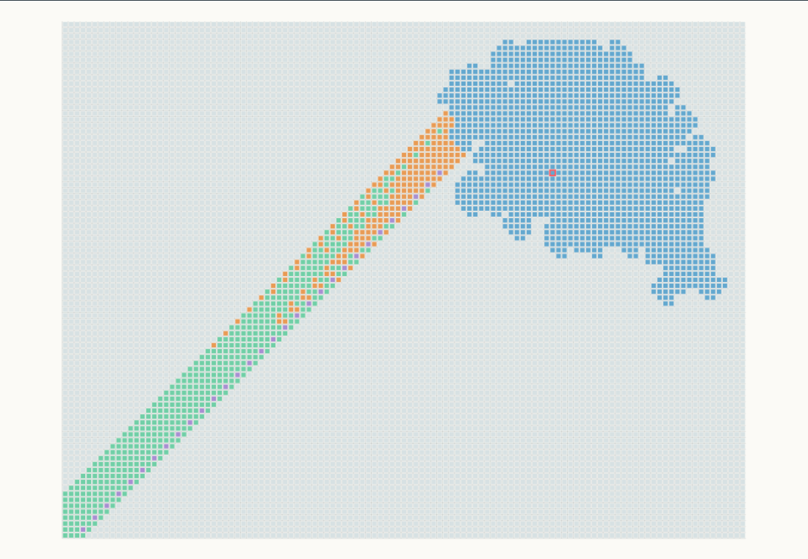

# One-black highways

Every classical Langton-ant state with exactly one black cell, at any ant
position and heading, eventually reaches the standard translating period-104
highway. The final Lean theorem establishes the complete future read trace of
a translated and rotated blank highway.

## Paper

Hao Ke, *Every One-Black-Cell Langton Ant Reaches the Period-104 Highway:
A Lean-Checked Proof*, version 0.2.0.
[Zenodo](https://doi.org/10.5281/zenodo.23341609) ·
[PDF](paper/paper.pdf) · [Source](paper/paper.md).

## Reproduce

From the repository root, with Python 3.10+ and Lean 4.30.0:

```sh
python3 one_black/reproduce.py
make -C one_black/paper
```

The verifier builds in a fresh temporary directory and checks both final
axiom lists. The finite certificates use three native computation leaves;
[`evidence/`](evidence/README.md) records the exact dependencies.
The paper build uses Pandoc and XeLaTeX and writes `paper/build/paper.pdf`.
The checked-in `paper/paper.pdf` is the published delivery PDF; the full-resolution
figures remain in `paper/figures/` for rebuilding.

## Sources

| Path | Contents |
|---|---|
| [paper/](paper/) | Manuscript, bibliography, original figures and published PDF |
| [PROOF.md](PROOF.md) | Proof narrative: 22 channels, 21+1 classification and wake isolation |
| [lean/](lean/) | Complete proof, finite witnesses and [standard-trace theorem](lean/StandardTrace.lean) |
| [evidence/](evidence/README.md) | Mathematical audit, clean-build log and source hashes |
| [release/](release/README.md) | Published version, source manifest and publication receipt |
| [langtons_ant/](langtons_ant/) | Exact dynamics for witness generation and downstream research |
| [media/](media/README.md) | Explanatory proof animations |

Witness tables are regenerated by `python3 one_black/lean/generate.py`;
verification checks the committed tables directly.

[](https://kehao95.github.io/langtons-ant-core/)

[Explore the interactive one-black proof guide](https://kehao95.github.io/langtons-ant-core/).
